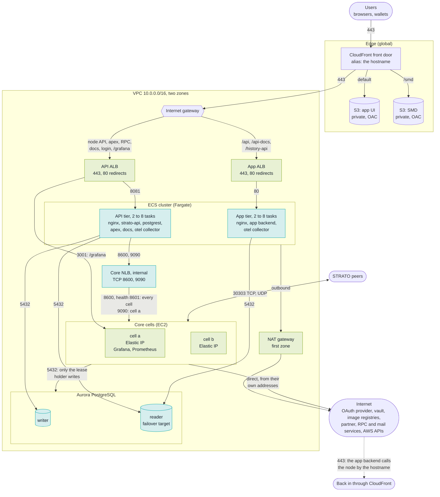

# Topology of one HA environment

What `scripts/ha.sh` deploys for one environment, where each part sits and
which part can reach which. `<env>` is the environment's name; every stack is
called `ha-<env>-...`.

Keep this file in step with the code: a change under `infra/` that adds or
removes a stack, a service, a container, a port, a CloudFront path or a
security-group rule updates the diagram and the tables here in the same
change. Where to check each kind of fact:

- What is deployed, and with which settings: `resolve` and the `ctx_*`
  functions in `scripts/ha.sh`, and `environments/example.env`.
- CloudFront paths: `API_PATHS` and `APP_PATHS` in
  `api-tier/lib/front-door-stack.ts`.
- Who is admitted where: the `addIngressRule` calls in each app's
  `lib/*-stack.ts`.
- Containers of a task: the `addContainer` calls in
  `api-tier/lib/api-tier-stack.ts` and `app-tier/lib/app-tier-stack.ts`.

## Diagram

Solid arrows point from the side that opens the connection. Green nodes sit
in the public subnets and teal ones in the private subnets; there is one
subnet of each kind per zone. Parts that span both zones (the load balancers,
each tier's tasks) are drawn once. Everything that enters or leaves the VPC
passes the internet gateway; only CloudFront's path is drawn through it.

The dashed arrow is the app backend calling the node through the public
hostname: out through the NAT gateway and back in through CloudFront. It ends
in a node of its own so that the graph has no cycle, which keeps the layout
top to bottom. The labels leave out the `*` of the CloudFront paths, because
the renderer reads a pair of them as emphasis; the table below has the exact
paths.

## Who reaches whom

| From | To | Port | What for |
| --- | --- | --- | --- |
| Users | CloudFront | 443 | Everything. The hostname's DNS record is a CNAME to the distribution, set by hand. |
| CloudFront | S3 buckets (app UI, SMD) | origin access control | Any path no other rule matches goes to the app UI (`/` redirects to `/dashboard/`). `/smd` and `/smd/*` go to the SMD. The buckets are private. |
| CloudFront | API ALB | 443 | `/strato/*`, `/strato-api*`, `/bloc/*`, `/cirrus/*`, `/apex-api*`, `/apex-ws/*`, `/rpc*`, `/docs*`, `/login*`, `/auth/*`, `/csrf-init`, `/health`, `/_ping`, `/grafana*`. |
| CloudFront | App ALB | 443 | `/api/*`, `/api-docs*`, `/history-api/*`. |
| API ALB | API tier tasks | 8081 | The task's nginx. It fronts strato-api (which also runs JSON-RPC and vm-query in the same container), postgrest, apex and the API docs. |
| API ALB | First cell | 3001 | Grafana, which runs its own OAuth login. |
| App ALB | App tier tasks | 80 | The task's nginx, which fronts the app backend. |
| API tier tasks | Core NLB, then a cell | 8600, 9090 | 8600 hands transactions to one healthy cell; the health check on 8601 covers every cell. 9090 is the first cell's Prometheus, read by apex. |
| API tier tasks | Aurora | 5432 | Writes (nonce counters) and apex use the writer endpoint. Other reads use the reader endpoint. |
| API tier tasks | Each other | 8546 | The vm-query fallback through ECS Service Connect. Each task uses its own vm-query first. |
| App tier tasks | Aurora reader | 5432 | The app backend's reads. |
| Cells | Aurora | 5432 | Every cell connects. Only the cell that holds the writer lease writes; the others are standbys. |
| Cells | STRATO peers, both ways | 30303 TCP, UDP | The chain's peer-to-peer traffic, on each cell's Elastic IP. Open to any address. |
| Cells | Internet, directly | any | From their own public addresses: vault for the node key, the image registry, the OAuth provider, and AWS APIs (S3 for snapshots, node scripts and the bootstrap; Systems Manager; CloudWatch). |
| API and app tasks | Internet, through the NAT gateway | any | Image pulls, Secrets Manager, Parameter Store, CloudWatch, X-Ray and the OAuth provider. The API tier also signs against vault. The app backend also calls its partner, RPC and mail services. |
| App backend | The node's API, by the hostname | 443 | The backend reaches the node only through the public hostname: NAT gateway, CloudFront, API ALB, API tier. |
| Deploy | CloudFormation, S3 node scripts, cells | AWS APIs | `scripts/ha.sh`, run by a pipeline or by hand: stacks through CloudFormation, node scripts to their bucket, upgrades and restarts on the cells through Systems Manager Run Command. There is no SSH. |

## Stacks

Nine stacks, plus two per cell: 13 with two cells and `OBSERVABILITY=true`.
They are deployed through the account's CDK bootstrap stack, which is not
counted here.

| Stack | What it owns |
| --- | --- |
| `ha-<env>-data-postgres` | The VPC: two zones, a public and a private /24 subnet in each, an internet gateway and one NAT gateway (`NAT_GATEWAYS=2` gives each zone its own). The Aurora PostgreSQL cluster (a writer and `PG_READERS` readers, encrypted, 7 days of backups), its security group, and two secrets: the master login and the node's login. |
| `ha-<env>-core-nlb` | The internal network load balancer, its security group and three target groups (transactions 8600, Prometheus 9090, Grafana 3001), and the bucket the cells install node scripts from. |
| `ha-<env>-cell-<id>-host` | One core cell: a launch template and an Auto Scaling group of exactly one EC2 instance, two encrypted gp3 volumes (root and data, both discarded with the instance), an Elastic IP, a security group and an instance role. |
| `ha-<env>-api-tier` | The ECS cluster with Container Insights and a Service Connect namespace. The API service (`API_DESIRED_COUNT` tasks, scaling on CPU up to four times that), its public load balancer with the `/grafana` rule, a log group, the session secret both tiers share, and the rules that admit its tasks on Aurora and on the core load balancer. |
| `ha-<env>-app-tier` | The app service in the same cluster (`APP_DESIRED_COUNT` tasks, scaling on CPU up to four times that), its public load balancer, a log group, and the rule that admits its tasks on Aurora. |
| `ha-<env>-api-frontdoor` | The CloudFront distribution, the two private buckets (app UI, SMD) with their origin access controls, two CloudFront functions for client-side routes, and the deployments that copy the UI builds in. |
| `ha-<env>-obs-core` | The two alarm topics (pages, warnings), the collector and agent configurations in Parameter Store, and the policy the collectors run under. |
| `ha-<env>-obs-alarms` | The CloudWatch alarms on Aurora, the two public load balancers and the cells, routed to those topics. |
| `ha-<env>-cell-<id>-network`, `ha-<env>-api-network`, `ha-<env>-app-network` | Nothing of their own. Each only looks up the shared VPC for its app. |

## Regional services

| Service | Created by these stacks | What for |
| --- | --- | --- |
| Parameter Store | yes | The node config the first cell publishes for both tiers, the collector configurations, the deploy state. |
| Secrets Manager | partly | Created: the database logins and the session secret. Made by hand beforehand: the OAuth client and the app backend's keys. |
| S3, node scripts | yes | The `bin/strato-*` scripts a cell installs. |
| CloudWatch | yes | Log groups of both tiers, the cells and Aurora; Container Insights; alarms. |
| SNS | yes | The two alarm topics. |
| CloudFormation | no | The stacks, through the CDK bootstrap stack. |
| S3, CDK assets | no | The cell bootstrap a new instance downloads, and the UI builds on their way to the front door's buckets. |
| S3, snapshots | no | `SNAPSHOT_BUCKET`: what a new cell restores. |
| ACM | no | `CERTIFICATE_ARN`: one certificate for CloudFront and both public load balancers. |
| Systems Manager | no | Run Command on the cells: upgrade, restart, state. |
| X-Ray | no | Traces from the collectors. |

## Worth knowing

- The cells sit in public subnets with Elastic IPs because peers must dial
  them. Peers reach every cell on 30303 from any address. The core NLB
  reaches every cell on 8600, 8601 and 9090, and the API ALB reaches the
  first cell on 3001. Nothing else gets in.
- Both public load balancers accept 80 and 443 from the whole internet, not
  only from CloudFront. There is no WAF.
- One NAT gateway, in the first zone, carries all outbound traffic of both
  tiers: image pulls, secrets, logs, and the app backend's calls to the
  node. If that zone fails, the tasks in the other zone lose their way out,
  unless `NAT_GATEWAYS=2`. There are no VPC endpoints.
- The app backend reaches the node only through the public hostname, so it
  depends on the NAT gateway, CloudFront and the API tier. All of its calls
  reach the API tier's nginx from the NAT gateway's address, which that nginx
  exempts from its per-address rate limits.
- The writer lease lives in Aurora. Each cell looks at it every ten seconds
  and claims it after three stale looks in a row, which is about a minute of
  silence from the writer.
- A cell is an Auto Scaling group of one instance. When EC2 loses the
  instance, or the cell's watchdog or `scripts/ha.sh <env> cells replace`
  marks it unhealthy, a new one boots, takes the cell's Elastic IP, restores
  the latest snapshot and joins the target groups. Both volumes go with the
  old instance.
- The first cell does three things alone: it publishes the node config to
  Parameter Store, which both tiers read when a task starts; it runs
  Grafana; and its Prometheus is the one apex reads.
- Aurora accepts connections only from the cells and the two tiers' tasks.
  Aurora chooses the zones of its instances, and a failover swaps the
  writer's and the reader's roles.

## Known gaps

- CloudFront and the app tier's nginx route `/history-api/*`, but
  `scripts/ha.sh` deploys no history service, so those requests answer 503.
